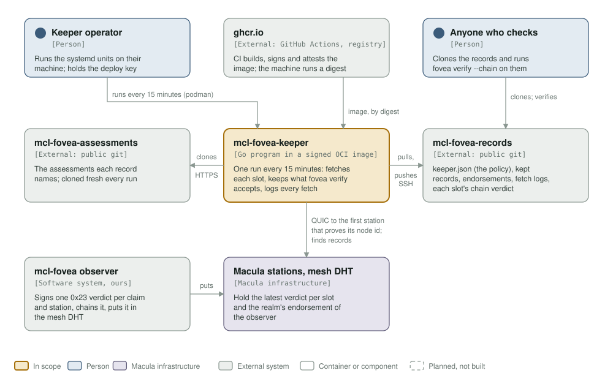
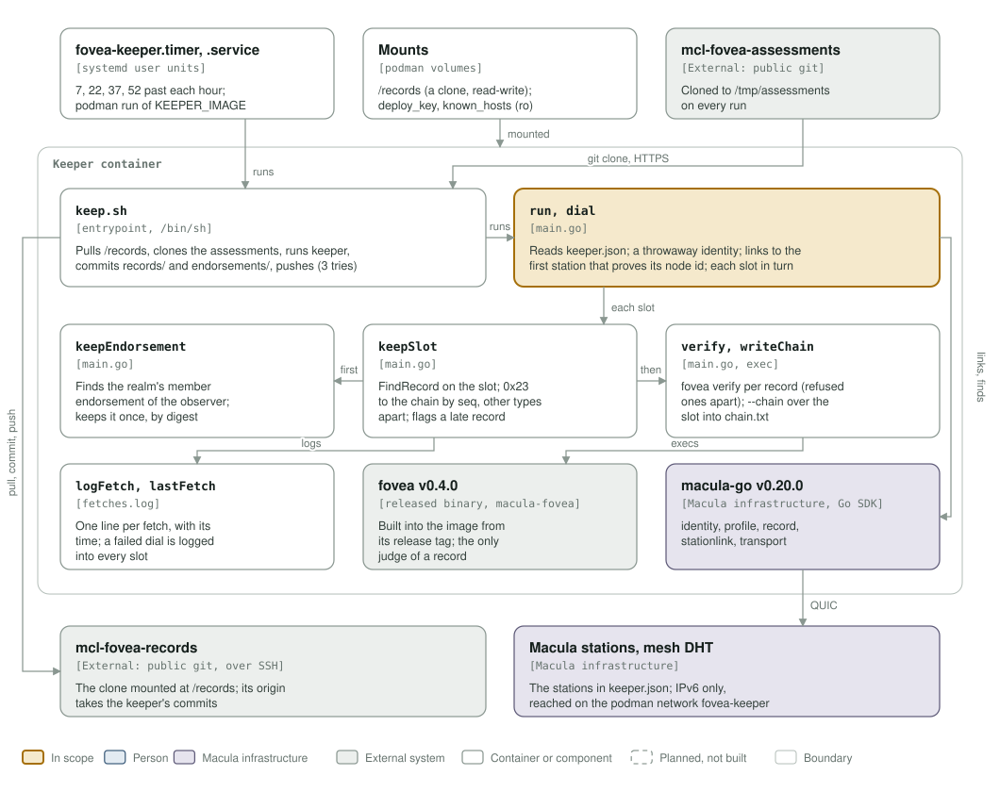

# mcl-fovea-keeper architecture: C4 model

*This exists so anyone can see what the keeper talks to and what it is made of, and check that against the code.*

**Status: 2026-10-22, unversioned** (no release tag yet; CI builds `ghcr.io/macula-io/mcl-fovea-keeper:latest` from `main`). Built and running: one Go program on [macula-go](https://github.com/macula-io/macula-go) v0.20.0, with the released `fovea` v0.4.0 and `keep.sh` in one signed image, run every 15 minutes by the user units in [`systemd/`](../systemd/). How the keeper sits beside the observer is drawn in mcl-fovea's own model (`assets/c4-keeper.svg` there); these two diagrams follow this repository's code.

Legend, the same as mcl-fovea's: amber is the element in scope, blue a person, lavender-grey **Macula infrastructure** (the stations and their DHT, the macula SDK), grey-green an external system, white a container or component, a thin rounded outline a boundary, and dashed boxes are planned, not built (none here).

## Level 1: system context

| Element | Kind | Role |
| --- | --- | --- |
| mcl-fovea-keeper | In scope | One run every 15 minutes: fetches each slot in `keeper.json`, keeps every record `fovea verify` accepts, logs every fetch with its time, writes each slot's chain verdict |
| Keeper operator | Person | Runs `fovea-keeper.timer` and `fovea-keeper.service` on their machine, names the image digest in `keeper.env`, holds the deploy key |
| Anyone who checks | Person | Clones mcl-fovea-records and runs `fovea verify --chain` on what the keeper kept |
| ghcr.io | External (GitHub Actions, registry) | `build-push.yml` builds the image, and macula-ci-images' `attest-image.yml` signs it by digest with an SBOM and provenance; the machine runs that digest |
| mcl-fovea-assessments | External (public git) | Cloned over HTTPS on every run (`keep.sh`): the assessment each verdict names, which `fovea verify` reads |
| mcl-fovea-records | External (public git) | Pulled and pushed over SSH with the deploy key: `keeper.json` (realm, profile, stations, slots), `records/`, `endorsements/`, `fetches.log`, `chain.txt` |
| Macula stations, mesh DHT | Macula infrastructure | The keeper links to the first station in `keeper.json` that proves its node id (QUIC, throwaway identity) and finds each slot's latest record and the realm's member endorsement of the observer |
| mcl-fovea observer | External (ours) | Signs one 0x23 verdict per claim and station and puts it in the DHT; the keeper never talks to it directly |

## Level 3: components

| Element | Kind | Role |
| --- | --- | --- |
| `fovea-keeper.timer`, `fovea-keeper.service` | systemd user units | 7, 22, 37 and 52 past each hour, Persistent; `podman run --network fovea-keeper` of `KEEPER_IMAGE` under a CPU and memory ceiling |
| Mounts | podman volumes | `/records` (a clone of mcl-fovea-records, read-write), `/etc/fovea-keeper/deploy_key` and `known_hosts` (read-only) |
| `keep.sh` | Entrypoint, `/bin/sh` | Pulls `/records`, clones mcl-fovea-assessments, runs `keeper`, commits `records/` and `endorsements/` and pushes, retrying three times with a rebase |
| `run`, `dial` | `main.go` | Reads `keeper.json`; generates a throwaway identity and dials each station in turn until one proves its node id; keeps every slot in turn |
| `keepSlot` | `main.go` | `FindRecord` on the slot; a 0x23 record is kept by `seq` in the chain, any other type apart under `other/`; a record dated more than 5 minutes before the previous fetch is flagged as published late |
| `keepEndorsement` | `main.go` | Computes the storage key of the realm's member endorsement of the observer, finds it and keeps a new one by digest |
| `verify`, `writeChain` | `main.go`, exec | `fovea verify` on each new record (refused ones go to `refused/`), then `fovea verify --chain` over the slot into `chain.txt` |
| `logFetch`, `lastFetch` | `fetches.log` | One line per fetch with its time; a failed dial is logged into every slot, so the keeper's own gap shows as its own |
| fovea v0.4.0 | External (released binary) | Installed into the image from macula-fovea's release tag (`FOVEA_VERSION` in the `Containerfile`); the only judge of a record |
| macula-go v0.20.0 | Macula infrastructure | `identity`, `profile`, `record`, `stationlink`, `transport` |

## Editing the diagrams

Both SVGs in [`../assets/`](../assets/) are generated by [`c4_diagrams.py`](c4_diagrams.py): run `python3 architecture/c4_diagrams.py` from the repository root, render each (`rsvg-convert -w 1400 assets/c4-context.svg -o /tmp/c.png`) and look at it. Colours are plain classes with a `prefers-color-scheme: dark` block, never CSS custom properties, which `rsvg-convert` renders black. Keep this file's tables in step with the diagrams. CI's `c4-model` job fails a commit that drops either diagram or stops showing it.
